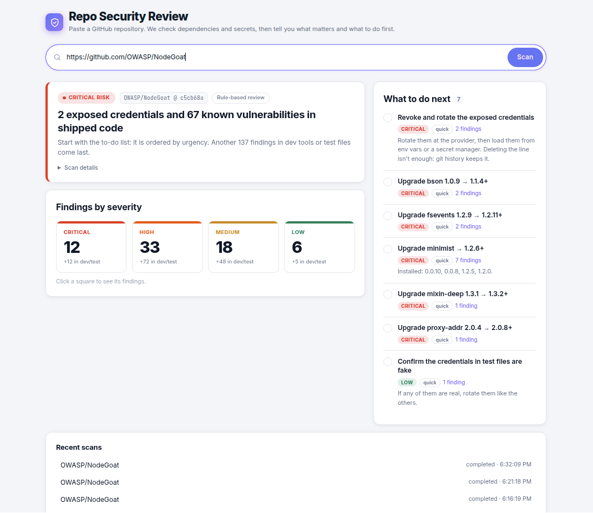
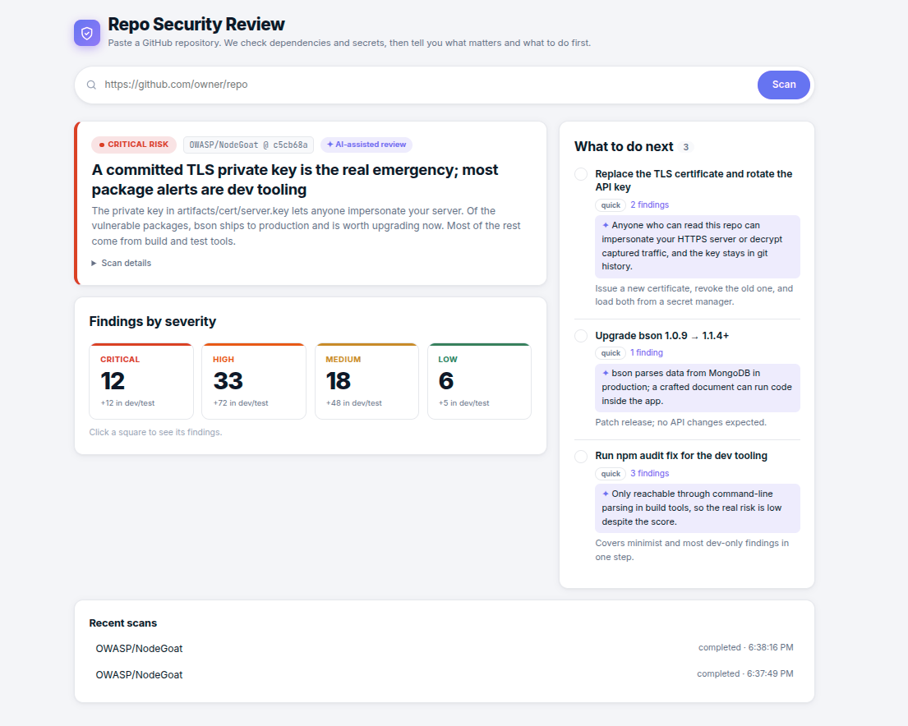

# Repo Security Review

Paste a GitHub repository URL and get answers to three questions: **how risky is it, what matters, and what should I do first?** You get a short report with an ordered to-do list, not a raw scanner dump.

Written in **Go** instead of Node.js + TypeScript, by agreement. It runs as a single binary with the UI embedded.

**Requirements:** Docker with Compose, internet access (scans reach GitHub and OSV.dev), and free ports 8080 and 5432. Optional: `ANTHROPIC_API_KEY` for the AI review and `GITHUB_TOKEN` for private repos. Without Docker you need Go ≥ 1.27 (an older Go downloads it automatically).

```bash
docker compose up --build         # app + Postgres, at http://localhost:8080
```

Set `ANTHROPIC_API_KEY` before running to add the AI review (Claude). Without Docker: `go run .` (scans kept in memory), or `DATABASE_URL=postgres://... go run .` to use your own Postgres.

Open http://localhost:8080 and paste e.g. `https://github.com/OWASP/NodeGoat`. A scan takes a few seconds.

Options: `-addr` (`:8080`), `-concurrency` (4 scans at once), `-timeout` (5m), `-model` (`claude-opus-5-5`), `GITHUB_TOKEN` for private repos.

Tests: `go test -race ./...` (offline). Opt-in: `E2E=1 go test ./internal/api -run E2E -v` scans NodeGoat for real, and `TEST_DATABASE_URL=<postgres url> go test ./internal/pgstore` tests against Postgres.

## The product

The user owns a repo but isn't a security specialist. Scanner reports give them hundreds of findings with equal weight and no decision. The result page is built around *what do I do first?*:

- **Verdict.** A risk level and a headline that counts only shipped code: "2 exposed credentials and 67 known vulnerabilities in shipped code". Dev and test findings are counted separately as lower priority.
- **Findings by severity.** Four squares (Critical, High, Medium, Low). Click one to see its findings, one row per package with every installed version and its fix version.
- **What to do next.** Beside the findings: an ordered to-do list with concrete steps ("Upgrade bson 1.0.9 → 1.1.4+", "Revoke and rotate the exposed credentials"), severity, effort, and links to the findings each step fixes.
- **Progress.** Each step reports as it finishes ("1091 packages checked, 98 vulnerable"), and failures are explained plainly ("repository not found or private").

**Without vs. with an API key.** Same scan of OWASP/NodeGoat, same findings. Without a key, the report is built by rules. With a key, Claude rewrites the headline, reorders and groups the to-do list, and explains why each item matters (✦).

| Without `ANTHROPIC_API_KEY` (rule-based) | With `ANTHROPIC_API_KEY` (AI-assisted) |
|---|---|
|  |  |

*The AI screenshot shows an example review served by a local stand-in for the Claude API, to show the UI without a paid key.*

**How urgency is decided.** Package severity comes from the advisory's CVSS score. Secrets have no CVSS score, so we chose: **critical** in real code, **low** in test files. The to-do list is then ordered by a simple score:

| Rule | Points |
|---|---|
| Severity: critical / high / medium / low | 40 / 30 / 20 / 10 |
| Secret in real code | +5 |
| Dev-only dependency or test/example file | −15 |

## How it works

```
POST /api/scans ─▶ runner (one goroutine per scan, max 4 at once, timeout)
                     1. clone          go-git, shallow
                     2. dependencies   osv-scanner → OSV.dev        ┐ in parallel
                     3. secrets        gitleaks                     ┘
                     4. review         rule-based report → Claude improves it (optional)
GET /api/scans/{id}  ◀── the UI polls every second
```

| Endpoint | |
|---|---|
| `POST /api/scans` | `{"repo_url": "..."}` → `202` with the scan; `422` if not a GitHub URL |
| `GET /api/scans` | recent scans |
| `GET /api/scans/{id}` | status, progress, stages, and the report when done |
| `GET /api/scans/{id}/report` | the report; `409` until done |

## Technical decisions

- **Standard scanners, no hand-written detection.** osv-scanner (Google) and gitleaks are the common open-source tools for vulnerable dependencies and secrets. Both are Go libraries, so there's nothing extra to install. Version comparison uses osv-scalibr's ecosystem-aware `semantic` package.
- **Scanners detect, AI judges.** Claude gets finding metadata only, never code or secret values, and returns a structured JSON review: verdict, ordering, explanations. One call per scan. Finding IDs it invents are dropped, so it can't add findings.
- **AI is optional and can't break a scan.** A rule-based report is always built first. Claude only replaces its wording when the call succeeds; otherwise the rule-based report stays, with a note. Refusal fallback is enabled so a false-positive safety refusal on security content retries on another model.
- **Scans are saved in Postgres.** Reports survive restarts, and scans cut off by a restart are marked failed instead of staying "running". The UI's progress polling reads from memory, so the database isn't hit every second. Postgres is optional: without `DATABASE_URL`, scans stay in memory.
- **Partial failure is OK.** Only a failed clone fails the scan. If the dependency or secret scan fails, the report says what's missing.
- **Simple over clever.** Polling instead of WebSockets, and a single page with no build step.

## Next steps

- **Less noise**
  - Name the package to upgrade: "Upgrade mocha, which brings in vulnerable minimist", not just "Upgrade minimist".
  - Rank a finding lower when the code never calls the vulnerable function (reachability analysis).
- **Wider coverage**
  - Look for secrets in git history, not only the current files.
- **Production**
  - Sign in with GitHub and pick a repo from a list, including private repos.
  - Compare a repo's scans over time: what's new and what got fixed since the last scan.
  - Run scans on separate workers fed by a job queue, so capacity grows by adding workers.

## How I used coding agents

I built this with **Claude Code**:

- **Design first.** The agent read the brief and proposed the flow, data model and libraries. I chose Go, minimal code, and existing scanner libraries.
- **Real APIs, not guesses.** It read the libraries' source to use them correctly, and ran real scans on NodeGoat to check the output.
- **UI from screenshots.** It screenshotted the page in headless Chrome. I reviewed each round and asked for changes: severity squares, the to-do list beside the findings, one row per package, numbers that add up.
- **Review and tests.** It reviewed the code for re-implemented packages and performance, and wrote a test file per source file plus an end-to-end test.
- **My decisions:** the product framing, what counts as noise, secret severity, and the AI boundary (metadata only, never blocking).
